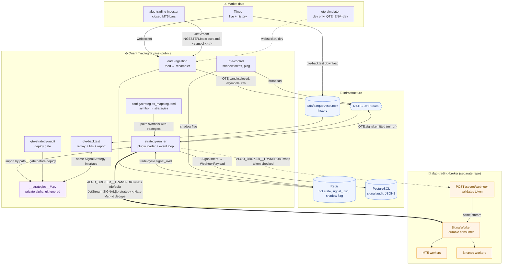

# Quant Trading Engine (QTE)

An event-driven framework for developing, backtesting and running quantitative
trading strategies. The engine is public; **your alpha is not** — strategies
live in `__strategies__/`, which is git-ignored here and cloned from your own
private repository at deploy time.

QTE ingests market data from a pluggable provider (Tiingo; MT5 through
[`algo-trading-ingester`](https://github.com/rockingrow/algo-trading-ingester);
a dev-only simulator you drive by hand), keeps hot state in Redis, audits every
signal into PostgreSQL, and publishes trade signals over NATS to
[`algo-trading-broker`](https://github.com/rockingrow/algo-trading-broker),
which fans them out to MT5 / Binance workers.

[Quick start](#-quick-start) · [Architecture](#-architecture) ·
[Core concepts](#-core-concepts) · [Commands](#-everyday-commands) ·
[Documentation](#-documentation)

---

## ⚡ Quick start

**Prerequisites:** Python 3.13 (pinned — the runner imports your strategy
plugins into its own process), [uv](https://docs.astral.sh/uv/), Docker and
Docker Compose. Tailscale is optional and runs as a container; see
[docs/tailscale.md](docs/tailscale.md).

```bash
# 1. Install
git clone https://github.com/rockingrow/quant-trading-engine
cd quant-trading-engine
cp .env.example .env                          # fill in QTE_DATA_PROVIDER_API_KEY at minimum
make tiingo                                   # config/data_providers/tiingo.toml: which symbols to feed
make install-dev                              # uv sync

# 2. Drop in a strategy — your private repo, into the git-ignored directory
git clone <your private strategy repo> __strategies__/my-strategies
make strategy-mount STRATEGY=my-strategies    # install its deps, then audit it
make strategy-mapping                         # config/strategies_mapping.toml: symbol → strategies
make audit                                    # is what the engine sees fit to trade?

# 3. Run it
make start-prod                               # the whole stack in Docker, shadow mode
make logs
```

- **Nothing private yet?** [`__strategies__/_boilerplate/`](__strategies__/_boilerplate/)
  is a committed template of a strategy repo. Copy it and start there. Run
  `make strategy-mount` at least once either way: the stack refuses to start
  without the file it writes.
- **No vendor key, no market open?** `make dev` runs the stack on a feed you
  drive by hand — [docs/simulator.md](docs/simulator.md).
- **Measuring rather than trading?** Go to [docs/backtesting.md](docs/backtesting.md).
- **Ready for real orders?** Signals reach no broker until you point
  `ALGO_BROKER__*` at the broker and turn shadow mode off —
  [docs/deployment.md](docs/deployment.md#going-live).

---

## 🏗️ Architecture



**The seam with `algo-trading-broker`.** QTE stops at the payload; the broker
owns execution. The runner emits exactly the `WebhookPayload` the broker
validates and publishes it onto the same JetStream subject the broker's own
webhook endpoint writes to, so QTE signals arrive through its normal durable,
de-duplicated path. The two repos share one contract and nothing else: no shared
database, no shared process, no import in either direction —
[docs/broker-contract.md](docs/broker-contract.md).

---

## 💡 Core concepts

**Event-driven.** Ingestion pushes; the runner reacts to a candle close; the
broker takes signals off a durable stream. Completed candles are staged in a
Redis outbox before publish, and live signals in Postgres before delivery, so
either path recovers with stable de-duplication IDs after a timeout or restart.

**Write once, run anywhere.** A strategy presents one method per broker action
— `long`, `short`, `tp1`, `tp2`, `sl`, plus an optional `r_sl` and `flat` — and
returns `SignalIntent` objects. The backtest replay and the live runner drive
that same interface with the same indicator code, so the file that produced a
backtest curve is the file that trades.

**Plugin / blackbox strategies.** The engine never contains an edge. It loads
strategies out of `__strategies__/` by file path — a mounted volume, not an
installed package — so the public engine and your private algorithms are
versioned and released independently. The contract is *structural*: a strategy
repo may restate `SignalStrategy` and `SignalIntent` on its own side and build,
test and release with this repo nowhere in sight. `qte-strategy-audit` is what
holds that freedom to a standard.

**The engine sizes, the strategy decides.** A strategy is never told the
balance; every entry is risk-sized in one place, from
`config/strategies_mapping.toml` and `QTE_ACCOUNT__*`, by the backtest and the
runner alike.

---

## 🛠️ Everyday commands

| Command | What it does |
| --- | --- |
| `make check` | Ruff + pytest — what CI runs |
| `make dev` / `make start-prod` | The stack with the simulator and live editing / production images |
| `make status` | Containers, then every link the running stack depends on |
| `make strategies` / `make audit` | What the engine can see / whether it is fit to trade |
| `make backtest STRATEGY=… SYMBOL=… TF=… FILE=…` | Replay a strategy over a parquet file, report and dashboard included |
| `make chart REPORT=<file>.json` | The HTML dashboard for a report |
| `uv run qte-control shadow status\|on\|off` | Read or flip the delivery pause on a running engine |
| `make db-upgrade` | Apply pending Alembic migrations |
| `make help` | Every target, one line each |

---

## 📚 Documentation

Everything beyond the quick start lives under [`docs/`](docs/).

**Guides** — how to do something:

| Document | What is inside |
| --- | --- |
| [Writing and deploying strategies](docs/strategies.md) | The seven-method interface, manifests and discovery, `make strategy-mount`, skipping a bundle, `DISABLED`, `BUNDLE_VERSION.json`, and the strategy audit |
| [Mapping and sizing](docs/mapping-and-sizing.md) | `config/strategies_mapping.toml`, risk-based sizing, trade cycles and the account-wide position ceiling |
| [Backtesting](docs/backtesting.md) | Downloading history, running a replay, cost profiles, the report and its dashboard |
| [Simulator walkthrough](docs/simulator.md) | Rehearsing the whole live path on one machine with no vendor key |
| [MT5 bars from algo-trading-ingester](docs/mt5-ingester.md) | The `mt5` provider: bars over NATS, the history request, schema versions |
| [Telegram](docs/telegram.md) | Position-lifecycle notifications, error forwarding, UP/DOWN, and the operator bot's commands |
| [Tailscale](docs/tailscale.md) | Reaching the broker over a tailnet: auth key, `.env`, how the relay works |
| [Operating a running engine](docs/operations.md) | Shadow mode, `make status`, recovering from an outage, the database |
| [Deployment](docs/deployment.md) | A clean server to a running stack, logs, images, and going live |

**Reference** — why it is built this way, and the contracts:

| Document | What is inside |
| --- | --- |
| [Architecture notes](docs/architecture.md) | Twenty "Why X" sections on decisions that are easy to reverse by accident |
| [Broker contract](docs/broker-contract.md) | Every `WebhookPayload` field, sizing, the trade cycle, the two transports |
| [Backtest report](docs/backtest-report.md) | The JSON schema, R-multiples, MAE/MFE and the diagnostics rule table |
| [State isolation](docs/state-isolation.md) | Paper, live and dev namespaces, and moving an existing deployment between them |

[`AGENTS.md`](AGENTS.md) holds the working rules every contributor and coding
agent follows; [`AUDIT.md`](AUDIT.md) the conventions they are checked against;
[`changelog.md`](changelog.md) what each release changed.
